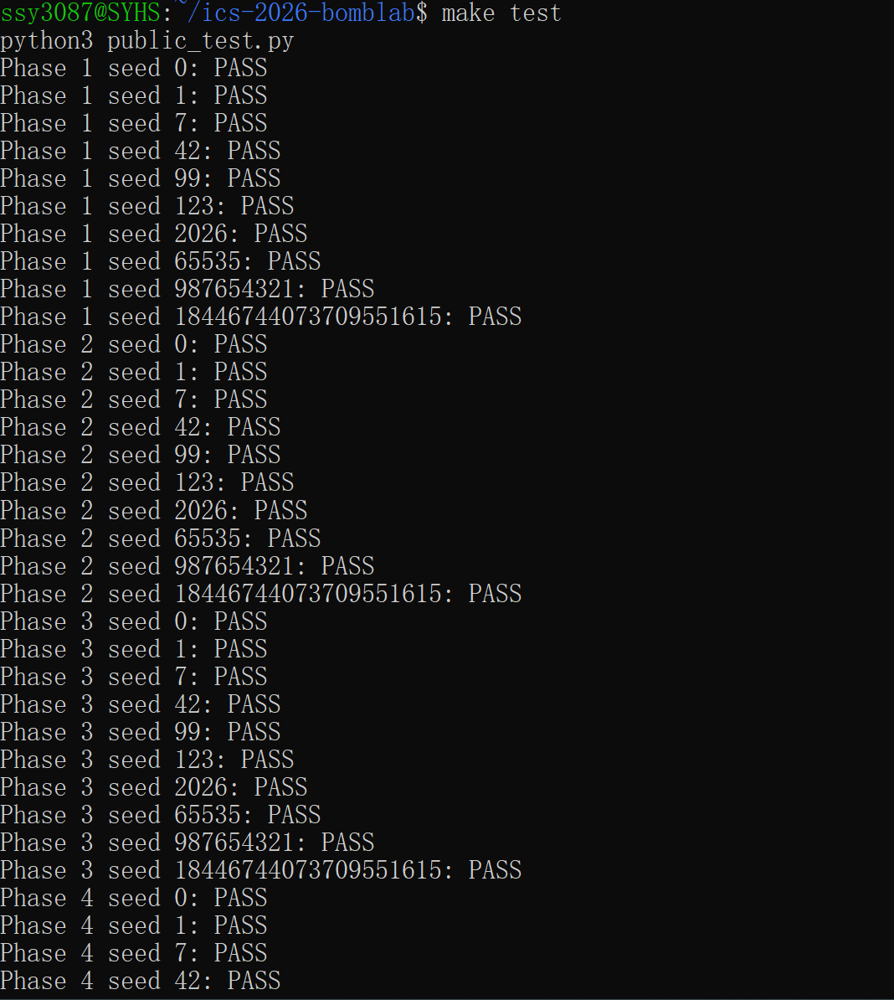
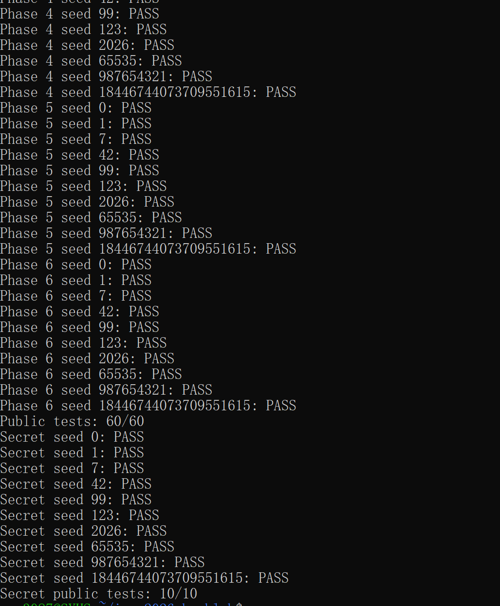

# CSAPP BombLab 实验报告

## 1. 实验环境
*   **系统环境**：Windows 11 + WSL2 (Ubuntu 22.04, Linux x86_64)
*   **工具链**：GCC, GNU Make, GDB, objdump
*   **完成情况**：已完成所有正式关卡（Phase 1 - 6）以及 Honor 关卡。

## 2. 各关卡关键汇编、计算关系与推理过程

### Phase 1：函数调用与参数传递
*   **关键汇编**：
    *   `shr $0x20,%rax` (获取 challenge 的高 32 位)
    *   `shr $0x10,%rdx` (获取 challenge 的中间 16 位)
    *   `lea (%rsi,%rdi,2),%eax` (地址计算实现 `x + 2y`)
*   **推理过程**：程序将 64 位 `challenge` 拆分为低 32 位、高 32 位和中间位。通过 `p1_step0`、`p1_step1`、`p1_step2` 三个子函数分别进行减法、异或和加法运算。
*   **计算关系**：
    *   `step2_res = (c_low + 0x3ccb) ^ c_high`
    *   `step0_res = 3 * (c_low - c_mid) + 0xdb47`
    *   `Answer = (step2_res ^ 0xa896) + 2 * step0_res`

### Phase 2：数组与循环
*   **关键汇编**：
    *   `and $0x3f,%eax` (取 6 位)
    *   `lea (%rsi,%rsi,2),%esi` (乘以 3)
    *   `xor %esi,%eax` (异或操作)
*   **推理过程**：通过循环计算 6 个整数。第一个数从 `challenge` 的高位提取。后续数字依赖前一个数字，每次提取 5 位加上索引，再与 `3 * values[i-1]` 异或。
*   **计算关系**：
    *   `v[0] = ((challenge >> 37) & 0x3f) ^ 8`
    *   `v[i] = (((challenge >> (16 + 2*i)) & 0x1f) + i) ^ (3 * v[i-1])`

### Phase 3：Switch 分支与跳转表
*   **关键汇编**：
    *   `and $0x7,%edi` (取低 3 位作为索引)
    *   `notrack jmp *0x405820(,%rax,8)` (间接跳转)
*   **推理过程**：根据 `challenge` 的低 3 位作为下标，利用跳转表跳转到 8 个不同的 `p3_case` 分支。第二个参数由 `(challenge >> 3) ^ (challenge >> 32)` 计算得出，代入对应的分支公式。
*   **计算关系**：`idx = challenge & 7`，`x = (challenge >> 3) ^ (challenge >> 32)`。根据 `idx` 执行如 `x * 5 + 0x40da8` 等运算。

### Phase 4：递归调用与二分查找
*   **关键汇编**：
    *   `and $0x7f,%edi` (目标值 0-127)
    *   `jb` (跳转实现递归的左子树)
*   **推理过程**：这是一个二分查找的递归过程。通过模拟二分查找的过程，记录左右子树的状态（`went_left`）。递归到底部（找到目标值）后，再通过循环回溯，利用 `k` 值进行乘 3 和异或运算还原出最终结果。
*   **计算关系**：
    *   `target = challenge & 0x7f`
    *   根据二分查找路径回溯：`r = (r * 3) ^ (mid + k) ^ (左/右标志 ? 0x12 : 0xa)`

### Phase 5：结构体布局与链表遍历
*   **关键汇编**：
    *   `mov 0x8(%rdx),%rdx` (访问链表 next 指针)
    *   `mov 0x4(%rdx),%esi` (访问结构体成员)
    *   `add (%rdx), %eax` (累加结点值)
*   **推理过程**：根据 `challenge` 的低 3 位选择 8 个链表头之一。根据 `(challenge >> 3) & 3` 决定遍历步数。在遍历过程中，提取节点的 value 和 tag，进行乘 3 累加和异或操作。
*   **计算关系**：
    *   `acc = ((challenge >> 6) ^ (challenge >> 32)) ^ 0xf28a`
    *   每次遍历：`acc = acc * 3 + node_value[node] ^ node_tag[node]`

### Phase 6：函数指针表与间接调用
*   **关键汇编**：
    *   `ror 5` / `rol 5` (循环移位)
    *   `call *%rax` (函数指针调用)
*   **推理过程**：程序根据 `challenge` 提取两个操作码索引 `idx[0]` 和 `idx[1]`，通过 `op_of` 数组映射到不同的操作（循环移位、异或等）。两次调用之间进行了状态更新，最后加上常量 `0x5c99`。
*   **计算关系**：提取 `idx[0]` 和 `idx[1]`，依次执行对应的位运算和算术运算，循环执行 2 次，最后 `Answer = x + 0x5c99`。

### Honor（Secret Phase）：字符串与异或混合
*   **关键汇编**：通过 `snprintf` 拼接字符串。
*   **推理过程**：结合 `challenge` 和 `context`，提取参数计算 `mix` 和 `salt`。最终构造的字符串包含 32 个 'A'，加上 "OPEN"，以及三个计算出的整数 `sel`、`second`、`third`。
*   **计算关系**：严格按照汇编逻辑，将字符串与计算出的 32 位无符号整数拼接输出。

## 3. 非公开 Seed 验证记录
使用未在 `public.json` 中出现的 Seed `888` 进行验证，结果如下：

```bash
# 验证命令
./defuser --seed 888 --phase 1 | ./bomb --seed 888 --phase 1
./defuser --seed 888 --phase 2 | ./bomb --seed 888 --phase 2
./defuser --seed 888 --phase 3 | ./bomb --seed 888 --phase 3
./defuser --seed 888 --phase 4 | ./bomb --seed 888 --phase 4
./defuser --seed 888 --phase 5 | ./bomb --seed 888 --phase 5
./defuser --seed 888 --phase 6 | ./bomb --seed 888 --phase 6

# 运行结果（截图）
运行 `make test` 的全通过截图如下：

